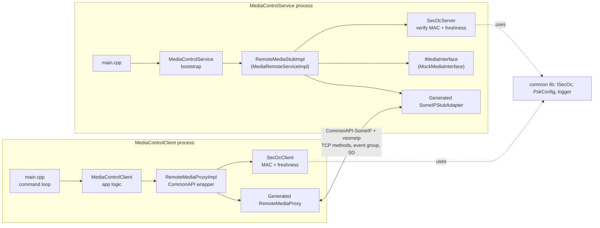
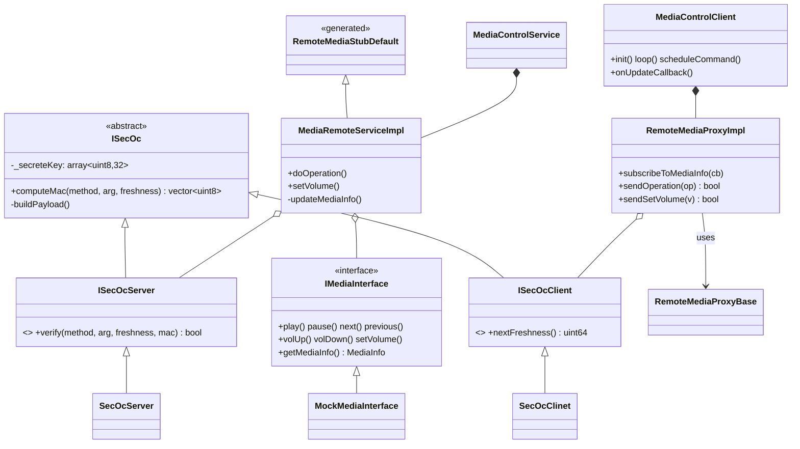
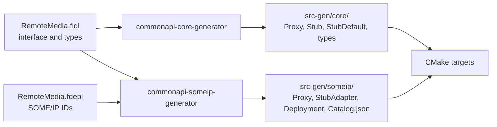
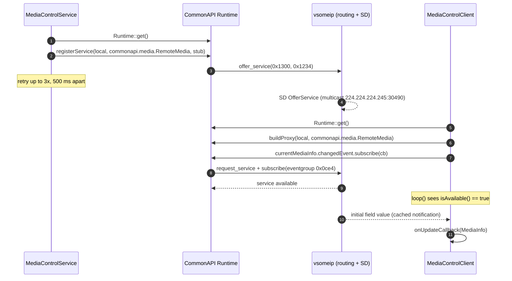
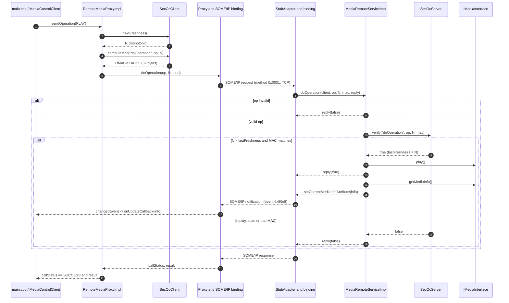
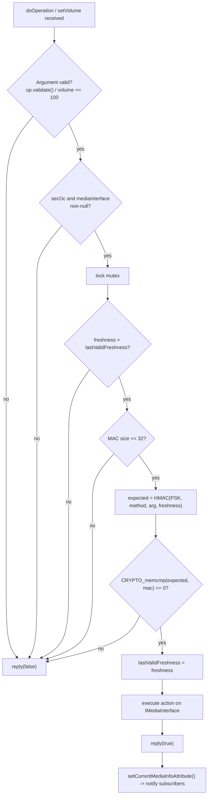
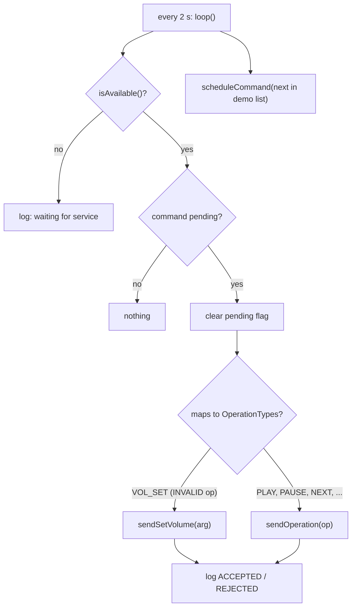

# MediaControl

A client/service pair that remotely controls a media player over **SOME/IP**, using **CommonAPI C++** as the application-facing API and **vsomeip** as the transport. Every command is authenticated with a simplified **SecOC**-style scheme (HMAC-SHA256 MAC and a monotonic freshness value).

- **Service** (`MediaControlService`): owns the media backend, validates commands, and broadcasts the current media state.
- **Client** (`MediaControlClient`): sends signed commands and subscribes to media-state updates.

> The media backend is a mock (`MockMediaInterface`) and the pre-shared key is hard-coded in `PskConfig.hpp`. This is a learning/reference project, not production security.

---

## Table of contents
1. [Interface](#1-interface-fidl--fdepl)
2. [Architecture](#2-architecture)
3. [Using CommonAPI](#3-how-commonapi-is-used)
4. [Runtime flows](#4-runtime-flows)
5. [Security (SecOC)](#5-security-secoc)
6. [Design decisions](#6-design-decisions)
7. [Project layout](#7-project-layout)
8. [Build, run, test](#8-build-run-and-test)
9. [Known limitations](#9-known-limitations)

---

## 1. Interface (FIDL / FDEPL)

The contract lives in [fidl/RemoteMedia.fidl](fidl/RemoteMedia.fidl) (what) and [fidl/RemoteMedia.fdepl](fidl/RemoteMedia.fdepl) (how it maps to SOME/IP).

| Element | Kind | Description |
|---|---|---|
| `currentMediaInfo` | attribute (readonly) | `MediaInfo{title, album, artist, currentVolume, isPlaying}`. Getter and change notification. |
| `doOperation(op, freshnessValue, mac) → success` | method | `op` ∈ `PLAY, PAUSE, NEXT, PREVIOUS, VOLUME_UP, VOLUME_DOWN, INVALID` |
| `setVolume(volumeLevel, freshnessValue, mac) → success` | method | Absolute volume, 0–100 |

SOME/IP deployment:

| Item | Value |
|---|---|
| Service ID / Instance ID | `0x1300` / `0x1234` |
| CommonAPI instance string | `commonapi.media.RemoteMedia` (domain `local`, version `v1_0`) |
| `doOperation` / `setVolume` method IDs | `1` / `2` (reliable, TCP) |
| `currentMediaInfo` getter / notifier / event group | `3000` / `33000` (`0x80e8`) / `3300` (`0x0ce4`) |
| Enum width | `OperationTypes` is 1 byte on the wire |
| Reliable port | `30509` (see [vsomeip.json](vsomeip.json)) |

---

## 2. Architecture



### Layers (top to bottom, per side)

| Layer | Client | Service |
|---|---|---|
| Application | `MediaControlClient` (availability, command scheduling, update callback) | `MediaControlService` (runtime, registration with retry) |
| CommonAPI glue | `RemoteMediaProxyImpl` (calls proxy, subscribes) | `MediaRemoteServiceImpl` (implements the stub, publishes attribute) |
| Security | `SecOcClient` (`nextFreshness`, `computeMac`) | `SecOcServer` (`verify`) |
| Domain backend | – | `IMediaInterface` / `MockMediaInterface` |
| Generated (`src-gen/`) | Proxy, SomeIP proxy | Stub, StubDefault, SomeIP stub adapter |
| Transport | CommonAPI-SomeIP, vsomeip | CommonAPI-SomeIP, vsomeip |

### Class view



---

## 3. How CommonAPI is used

### 3.1 What CommonAPI provides

```
+------------------------------------------------------+
|  Application (MediaControlClient / MediaControlService)  |
+------------------------------------------------------+
|  CommonAPI generated API: Proxy / Stub  (src-gen/core)   |  <- binding independent
+------------------------------------------------------+
|  CommonAPI Core Runtime (Runtime, factories, loading)    |
+------------------------------------------------------+
|  CommonAPI-SomeIP binding (src-gen/someip)               |  <- binding specific
+------------------------------------------------------+
|  vsomeip (routing, service discovery, serialization I/O) |
+------------------------------------------------------+
```

The application only talks to the generated **core** API. The SOME/IP specifics (IDs, serialization, event groups) are generated into `src-gen/someip` and loaded at runtime. Swapping the binding (for example to D-Bus) would not touch application code.

### 3.2 Code generation



`src-gen/` is committed and built by [CMakeLists.txt](CMakeLists.txt) into three shared libraries:

| Library | Contents |
|---|---|
| `libMediaControlsomeipcommon.so` | Type and interface deployment (shared by both sides) |
| `libMediaControlsomeipproxy.so` | SOME/IP proxy, loaded by the client |
| `libMediaControlsomeipstub.so` | SOME/IP stub adapter, loaded by the service |

### 3.3 Runtime binding and configuration

[commonapi4someip.ini](commonapi4someip.ini) maps the CommonAPI address to the binding libraries. They are loaded dynamically by the runtime:

```ini
[default]
binding=someip

[proxy]
local:commonapi.media.RemoteMedia:v1_0:commonapi.media.RemoteMedia=libMediaControlsomeipproxy.so

[stub]
local:commonapi.media.RemoteMedia:v1_0:commonapi.media.RemoteMedia=libMediaControlsomeipstub.so
```

The address `domain:interface:version:instance` is translated to SOME/IP service `0x1300` / instance `0x1234` using the deployment from the FDEPL. [vsomeip.json](vsomeip.json) configures vsomeip: the application names and IDs, the reliable port, the event and event group, service discovery, and the routing master. `MediaControlService` is the routing host.

### 3.4 Service side

```cpp
// MediaControlService::init()
_runtime = CommonAPI::Runtime::get();
auto service = std::make_shared<MediaRemoteServiceImpl>(std::move(secoc), std::move(backend));
_runtime->registerService("local", "commonapi.media.RemoteMedia", service, "MediaControlService");
```

- `MediaRemoteServiceImpl` extends the generated `RemoteMediaStubDefault`, so only the two methods need to be overridden (`doOperation`, `setVolume`).
- Replies are asynchronous through the supplied `reply(bool)` callback.
- State is published with `setCurrentMediaInfoAttribute(...)`. CommonAPI sends the SOME/IP notification to all subscribers.
- Registration is retried 3 times at 500 ms intervals, because the vsomeip routing may not be ready at startup.

### 3.5 Client side

```cpp
// MediaControlClient::init()
_runtime = CommonAPI::Runtime::get();
_proxy   = _runtime->buildProxy<RemoteMediaProxy>("local", "commonapi.media.RemoteMedia", "MediaControlClient");

// subscribe to the attribute change event
_proxy->getCurrentMediaInfoAttribute().getChangedEvent().subscribe(cb);

// synchronous call
_proxy->doOperation(op, freshness, mac, callStatus, result);
```

- `buildProxy` returns immediately. `isAvailable()` tells whether service discovery has found the service, and `loop()` skips sending until it has.
- The synchronous proxy API is used. Success is `callStatus == SUCCESS && result`, which separates transport failure from a rejected command.
- The subscription handle is stored in `RemoteMediaProxyImpl` and unsubscribed in its destructor (RAII).
- The update callback captures a `weak_ptr` to `MediaControlClient`, so late notifications cannot call into a destroyed object.

---

## 4. Runtime flows

### 4.1 Startup and discovery



### 4.2 Command flow (`doOperation` / `setVolume`)



### 4.3 Server-side validation



### 4.4 Client loop



The demo `main.cpp` cycles through PLAY, PAUSE, NEXT, PREVIOUS, VOL_UP, VOL_SET(75), VOL_DOWN and VOL_SET(150). The last one is deliberately out of range and must be rejected.

---

## 5. Security (SecOC)

A simplified take on AUTOSAR SecOC: authenticity and replay protection for each command.

```
MAC = HMAC-SHA256( PSK, methodName || argByte || freshness[8 bytes, big-endian] )
```

| Property | How it is achieved |
|---|---|
| Authenticity and integrity | HMAC-SHA256 over method name, the argument, and freshness, with a shared 256-bit key |
| Replay protection | The server accepts a command only if `freshness > lastValidFreshness`. Accepted commands update it. |
| Cross-method protection | The method name is part of the MAC input, so a `doOperation` MAC cannot be reused for `setVolume`. |
| Timing safety | MAC comparison uses `CRYPTO_memcmp` (constant time). |
| Atomicity | `verify` and the state change run under a mutex, because CommonAPI may call the stub from several threads. |

The `ISecOc` base provides `computeMac` / `buildPayload` as `final`, so client and server cannot compute the MAC differently. `ISecOcClient` adds `nextFreshness()` and `ISecOcServer` adds `verify()`.

---

## 6. Design decisions

| Decision | Rationale | Trade-off |
|---|---|---|
| **CommonAPI instead of raw vsomeip** | Transport-agnostic application code. Types, serialization and IDs are generated from one FIDL/FDEPL. Typed, async-capable API. | Code generation step, extra runtime libraries, indirection. |
| **FIDL is the single source of truth** | Client and service cannot drift apart. Changing the interface regenerates both sides. | `src-gen/` must be regenerated and kept in sync. |
| **Commands as methods, state as an attribute** | Methods carry request and response (accepted/rejected). The `readonly` attribute with a notifier gives push-based state and late-joiner initial value, without polling. | Success is a boolean, with no error codes. |
| **Reliable (TCP) methods** | Control commands must not be lost. | Slightly higher latency than UDP. |
| **Only 2 methods (`doOperation` + enum, `setVolume`)** | Small surface. New simple commands need only a new enum value. | Requires changing the FIDL version for new operations. |
| **Security in the payload (SecOC-style), not the transport** | Works regardless of binding. Mirrors automotive practice, where the MAC and freshness travel with the PDU. | Duplicates what TLS could give. Key distribution is out of scope. |
| **Freshness counter plus MAC (no timestamps)** | No clock synchronisation needed. | The counter is in-memory. After a restart the client starts at 0 and is rejected while the server remembers a higher value. |
| **`ISecOc` with a `final` MAC computation** | One implementation shared by both roles. Roles differ only in freshness handling. | Name-based payload building is simple, not AUTOSAR-compliant. |
| **Dependency injection (SecOc and media backend passed in as `unique_ptr` to interfaces)** | Unit testing with GMock (see `test/`). The real player can replace the mock without touching the stub. | Slightly more boilerplate. |
| **Thin CommonAPI wrapper (`RemoteMediaProxyImpl`, `MediaRemoteServiceImpl`)** | Generated code is isolated. Business logic and security live in testable classes. | One extra layer. |
| **Separate static libs (`common`, `clientLib`, `serverLib`) and shared SOME/IP libs** | Tests link the libs directly. The SOME/IP libs are loaded dynamically by CommonAPI as the binding requires. | More CMake targets. |
| **`weak_ptr` in the subscription callback, RAII unsubscribe** | No use-after-free from asynchronous notifications. | Requires `enable_shared_from_this` and creation through `make_shared`. |
| **Service registration retry** | Tolerates start order and routing-manager readiness. | Fixed retry count. |
| **Client-side range check plus server-side range check** | Fails fast locally, but the server never trusts the client. | Duplicate rule. |
| **Service is the vsomeip routing host** | Simple single-host setup without an external `vsomeipd`. | The client depends on the service process for local routing. |

---

## 7. Project layout

```
MediaControl/
├── fidl/
│   ├── RemoteMedia.fidl            # interface + types
│   └── RemoteMedia.fdepl           # SOME/IP deployment
├── src-gen/                        # generated by CommonAPI generators
│   ├── core/{common,proxy,stub,skel}/...
│   └── someip/{common,proxy,stub}/...
├── src/
│   ├── common/                     # shared lib
│   │   ├── secoc/ISecOc.*          # MAC computation
│   │   ├── secoc/PskConfig.hpp     # pre-shared key
│   │   └── logger/logger.hpp
│   ├── client/
│   │   ├── main.cpp
│   │   ├── client/MediaControlClient.*
│   │   ├── someIp/RemoteMediaProxyImpl.*
│   │   └── secoc/{ISecOcClient,SecOcClient}.*
│   └── server/
│       ├── main.cpp
│       ├── service/MediaControlService.*
│       ├── someIp/RemoteMediaStubImpl.*
│       ├── mediaInterface/{IMediaInterface,MockMediaInterface}.hpp
│       └── secoc/{ISecOcServer,SecOcServer}.*
├── test/                           # GoogleTest + GMock
├── commonapi4someip.ini            # CommonAPI binding config
├── vsomeip.json                    # vsomeip config
└── CMakeLists.txt
```

---

## 8. Build, run and test

Prerequisites: CommonAPI core runtime ≥ 3.2.0, CommonAPI-SomeIP ≥ 3.2.0, vsomeip ≥ 3.7.0, OpenSSL, DLT (`automotive-dlt`) and CMake ≥ 3.16. See the [top-level README](../README.md) and `envsetup.sh` for environment setup.

```bash
cd MediaControl
cmake -B build -S .
cmake --build build -j

# Terminal 1: service (also the vsomeip routing host)
cd build
COMMONAPI_CONFIG=../commonapi4someip.ini \
VSOMEIP_CONFIGURATION=../vsomeip.json \
VSOMEIP_APPLICATION_NAME=MediaControlService \
LD_LIBRARY_PATH=. ./MediaControlService

# Terminal 2: client
COMMONAPI_CONFIG=../commonapi4someip.ini \
VSOMEIP_CONFIGURATION=../vsomeip.json \
VSOMEIP_APPLICATION_NAME=MediaControlClient \
LD_LIBRARY_PATH=. ./MediaControlClient

# Unit tests
ctest --test-dir build
```

The vsomeip application name must match an entry in `vsomeip.json`. Logging goes to `mylog.log` (CommonAPI) and DLT.

Expected client log (one command every 2 s):
```
[CLIENT] sendOperation(PLAY) -> ACCEPTED
[BROADCAST] with title: ... Vol: 20 playing: 1
...
[CLIENT] setVolume(150) -> REJECTED
```

Tests cover MAC computation (`test/common`), client and server SecOC (`test/client`, `test/server`), and the proxy and stub wrappers with mocked collaborators.

---

## 9. Known limitations

- The PSK is compiled in (`PskConfig.hpp`). A real system needs secure provisioning.
- Freshness is not persisted. Restarting only one side desynchronises the counters until the client counter passes the server's.
- A single freshness counter is shared by all clients on the service, so a second client would interfere with the first.
- `updateMediaInfo` is invoked after `reply(true)`, so the response and notification are not ordered atomically.
- `MediaControlService::loop()` only logs. All work happens in CommonAPI callbacks.
- Class `SecOcClinet` is a typo kept in the code. Rename it for consistency.
